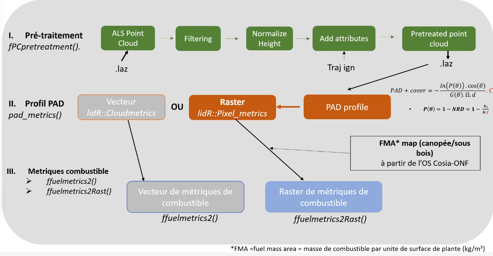

# LidarForFuel industrialization

This repo contains the code [lidarForFuel](https://github.com/oliviermartin7/LidarForFuel) written with R and developped by Olivier Martin : that code be re-written to accommodate specified changes to industralization.


## Content

lidarforfuel aims to compute fuel metrics from airborne LiDAR data and map them at a large scale. Currently, two R functions have been developed:
1) fPCpretreatment: pretreatment of a point cloud
2) pad_metrics: calculate PAD and
3) ffuelmetrics2Rast(): computing fuel metrics. These functions can be used either at the plot scale for specific analyses on small areas or at a large scale using a catalog of LiDAR tiles from the lidR package.



It is important to note that the function fCBDprofile_fuelmetrics for computing fuel metrics/profile needs as entry a pretreated point cloud obtained with the fPCpretreatment.


# Installation / Usage

This library can be used in different ways:
* directly from sources: `make install` creates a mamba environment with the required dependencies
* installed with `pip` from pypi: ` pip install lidar_for_fuel`
* used in a docker container: see documentation [Dockerfile](Dockerfile)

## Launching the steps

Each step is a [Hydra](https://hydra.cc) entry point: its parameters are in [configs/config.yaml](configs/config.yaml) and can be overridden on the command line. Each one runs on a single file (`io.input_filename`) or on all the files of a folder (`io.input_dir`), and writes its outputs in `io.output_dir`.

### Step 2 — PAD profile

```bash
python -m lidar_for_fuel.main_pad_profile io.input_dir=<preprocessed tiles> io.output_dir=<output dir>
```

Writes 8 rasters per tile in `io.output_dir`, among which `{stem}_pad_profile_1m.tif`, the PAD of the 1 m strata (bands `PAD_{dz}_{h_bottom}`), input of step 3. Example: [scripts/example_launch_pad_profile.sh](scripts/example_launch_pad_profile.sh).

### Step 3 — Fuel metrics

```bash
python -m lidar_for_fuel.main_fuel_metrics io.input_dir=<step 2 output dir> io.output_dir=<output dir>
```

- **Input**: the `*_pad_profile_1m.tif` files of `io.input_dir` (the other step 2 rasters of the folder are ignored), or only `io.input_filename` if it is set: a file name inside `io.input_dir`, which stays required.
- **Parameters**: the `fuel_metrics` section of the config (INRAE values by default). `fma_can` and `fma_shrub` are a value in [0.05, 0.5] kg/m² or the path to the FMA map; `pad_max` is the PAD cap applied when the PAD raster is read (5 by default). The parameters, an FMA value and the existence of an FMA map path are checked before the first tile: an invalid value raises an error that names its key. The values of an FMA map are checked tile by tile.
- **Output**: one `{stem}_fuel_metrics.tif` per tile (the `_pad_profile_1m` suffix is removed), on the grid of the PAD raster (10 m), one float32 band per metric, nodata NaN, named and ordered as in R `ffuelmetrics2`. The number of bands depends on the config: 19 + 8 × (number of ladder fuel thresholds) + (number of canopy top thresholds), i.e. 45 with the default config. Pixels without data (all-NaN PAD, or no FMA) are NaN on all the bands. The list of the bands is in [docs/epic-3-fuel-metrics.md, §3.2](docs/epic-3-fuel-metrics.md#32-sortie).

Example: [scripts/example_launch_fuel_metrics.sh](scripts/example_launch_fuel_metrics.sh).

## Project tree


* `.github/`: folder containing issue templates and GitHub Actions;
* `.vscode/`: folder containing a VS Code configuration for the project;
* `configs/`: folder containing YAML file to configure the code;
* `doc/`: folder containing documentation .md files (e.g., install.md);
* `data/`: folder containing data for tests;
* `img/`: folder containing images;
* `lidar_for_fuel/`: folder contains the code;
* `scripts/`: folder contains examples for lauching the code;
* `tests/`: scripts and instructions for running tests;
* `README.md`: this file


# Dev / Build

## Contribute

Every time the code is changed, think of updating the version file: [lidar_for_fuel/_version.py](lidar_for_fuel/_version.py`)

Please log your changes in [CHANGELOG.md](CHANGELOG.md)

To lint the code automatically on commit, install the precommit hooks with ```make install-precommit```

## Tests

Create the conda environment: `make install`

Run unit tests: `make testing`

## Pip package

To generate a pip package and deploy it on pypi, use the [Makefile](Makefile) at the root of the repo:

* `make build`: build the library
* `make install`: update environment with mamba
* `make deploy` : deploy it on pypi

## Docker image

To build a docker image with the library installed: `make docker-build`

To test the docker image: `make docker-test`


# Contacts


| Nom      | Prénom  | mail                  | fonction |
| -------- | ------- | --------------------- | -------- |
| DUPAYS   | Malvina | malvina.dupays@ign.fr | DSI IGN  |
| VAUCHIER | Lea     | lea.vauchier@ign.fr   | DSI IGN  |
